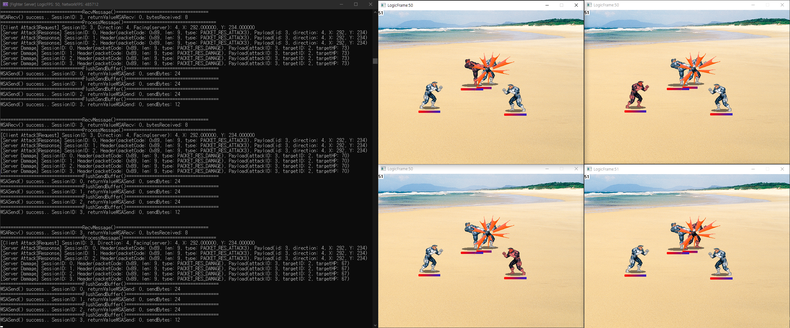

# 2D Fighter Server 만들기
* select 모델을 사용하여 간단한 2D게임의 서버 제작
* 클라이언트는 이미 제작 되어있는 상태로 프로토콜을 맞춰 서버만 직접 제작
* 직접만든 [링버퍼](https://github.com/fkdla124/RingBuffer), [리스트](https://github.com/fkdla124/LinkedList) 사용

# 작동 이미지

