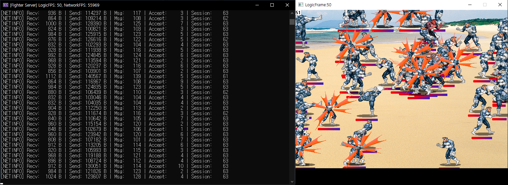

# [미니프로젝트] 2D Fighter Server
* select 모델을 사용하여 간단한 2D게임의 서버 제작
* 클라이언트는 이미 제작 되어있는 상태로 프로토콜을 맞춰 서버만 직접 제작
* 직접만든 [링버퍼](https://github.com/fkdla124/RingBuffer), [리스트](https://github.com/fkdla124/LinkedList), [직렬화 버퍼](https://github.com/fkdla124/MsgBuf) 사용
* RPC 사용 [RPC](https://github.com/fkdla124/RpcGen)

# 서버 작동 이미지


# 더미테스트 이미지 (AI로 만든 더미클라 + 내 서버)


# 📦 Message Protocol
```cpp
#pragma once

// byte order
#pragma pack(push, 1)

/////////////////////////////////////////////////////////////////////////////////
// Header

struct MessageHeader
{
	char packetCode;
	char len;
	char type;
};

/////////////////////////////////////////////////////////////////////////////////


/////////////////////////////////////////////////////////////////////////////////
// Player Create/Delete

// type = 0, RES
struct CreatePlayer
{
	int id;
	char direction;
	short x;
	short y;
	char hp;
};

// type = 1, RES
struct CreateOther
{
	int id;
	char direction;
	short x;
	short y;
	char hp;
};

// type = 2, RES
struct DeletePlayer
{
	int id;
};

/////////////////////////////////////////////////////////////////////////////////

/////////////////////////////////////////////////////////////////////////////////
// Move

// type = 10, REQ
struct MoveStart
{
	char direction;

	// 목적지 기반 이동 동기화에선 안 넣는게 정석 구현.
	// 지금은 목적지(더미) 기반 이동 동기화가 아님!!
	short x;
	short y;
};

// type = 11, RES
struct MoveStartOther
{
	int id;
	char direction;

	short x;
	short y;
};

// type = 12, REQ
struct MoveStop
{
	char direction;
	short x;
	short y;
};

// type = 13, RES
struct MoveStopOther
{
	int id;
	char direction;
	short x;
	short y;
};

/////////////////////////////////////////////////////////////////////////////////


/////////////////////////////////////////////////////////////////////////////////
// Attack

// type = 20, REQ
struct Attack1Request
{
	char direction;
	short x;
	short y;
};

// type = 21, RES
struct Attack1Response
{
	int id;
	char direction;
	short x;
	short y;
};

// type = 22, REQ
struct Attack2Request
{
	char direction;
	short x;
	short y;
};

// type = 23, RES
struct Attack2Response
{
	int id;
	char direction;
	short x;
	short y;
};

// type = 24, REQ
struct Attack3Request
{
	char direction;
	short x;
	short y;
};

// type = 25, RES
struct Attack3Response
{
	int id;
	char direction;
	short x;
	short y;
};

// type = 30, RES
struct Damage
{
	int attackID; // 공격자
	int damageID; // 피해자
	char damageHP; // 피해자 남은 HP
};

/////////////////////////////////////////////////////////////////////////////////

#pragma pack(pop)
```

# main()
* while()문 FPS 제한이 없음. Network() 처리를 최대한 빠르게 하기 위함.
* 다만 GameLogic() 함수는 호출 자체는 매 루프마다 하지만 실제 작동은 1초에 50번만 가능하도록 조건에 맞춰 조기리턴하여 50 LogicFPS를 제한
```cpp
int main()
{
	StartServer();

  	// Server Main Loop
	while (isServerRunning)
	{
		Network();

		GameLogic();
	}

	StopServer();

	return 0;
}
```

# Network() 
* FPS 제한없이 최대한 빠르게 반복
* 공격 충돌처리 네트워크에서 바로 처리
```cpp
void Network()
{
	fd_set rset;
	fd_set wset;
	FD_ZERO(&rset);
	FD_ZERO(&wset);

	// select 처리
	int selectCount = SelectSocketEvents(&rset, &wset);

	// accept
	if (selectCount > 0 && FD_ISSET(listenSocket, &rset))
	{
		AcceptClient();
		--selectCount;
	}

	for (List<Session*>::Iterator it = sessionList.begin(); (selectCount > 0 && it != sessionList.end()); ++it)
	{
		// rset 처리
		if (FD_ISSET((*it)->sock, &rset))
		{
			// TCP 수신버퍼 -> 수신링버퍼 메시지 수신 (WSARecv -> RingBuffer)
			RecvMessage((*it));

			// 수신링버퍼 메시지 처리
			ProcessMessage((*it));

			// 처리할 세션이 더 이상 없다면 나머지 세션은 확인 X
			--selectCount;
		}

		// wset 처리
		if (FD_ISSET((*it)->sock, &wset))
		{
			// 송신링버퍼 플러쉬
			FlushSendBuffer((*it));

			// 처리할 세션이 더 이상 없다면 나머지 세션은 확인 X
			--selectCount;
		}
	}

	// 지연삭제
	SweepMarkedSession();
}
```

# GameLogic() 
* 50FPS로 클라와 동일하게 제어.
* 로직프레임이 50 아래로 떨어지더라도 시간 기반 이동으로 동기화.
```cpp
void GameLogic()
{
  	// 이번 로직 deltaTime 계산
	deltaTime = timeGetTime() - gameLogicTick;

	// Logic FPS 제한
	if (deltaTime < (1000 / GAME_LOGIC_FPS_LIMIT))
		return;

	// 기준틱 갱신
	gameLogicTick = timeGetTime();

	for (List<Session*>::Iterator it = sessionList.begin(); it != sessionList.end(); ++it)
	{
		if ((*it)->move == true)
		{
			switch ((*it)->direction)
			{
				case PACKET_MOVE_DIR_DD: // ↓
					MovePlayer((*it), 0, 1);
					break;
				case PACKET_MOVE_DIR_RD: // ↘
					MovePlayer((*it), 1, 1);
					break;
				case PACKET_MOVE_DIR_RR: // →
					MovePlayer((*it), 1, 0);
					break;
				case PACKET_MOVE_DIR_RU: // ↗
					MovePlayer((*it), 1, -1);
					break;
				case PACKET_MOVE_DIR_UU: // ↑
					MovePlayer((*it), 0, -1);
					break;
				case PACKET_MOVE_DIR_LU: // ↖
					MovePlayer((*it), -1, -1);
					break;
				case PACKET_MOVE_DIR_LL: // ←
					MovePlayer((*it), -1, 0);
					break;
				case PACKET_MOVE_DIR_LD: // ↙
					MovePlayer((*it), -1, 1);
					break;
			}
		}
	}
}
```
